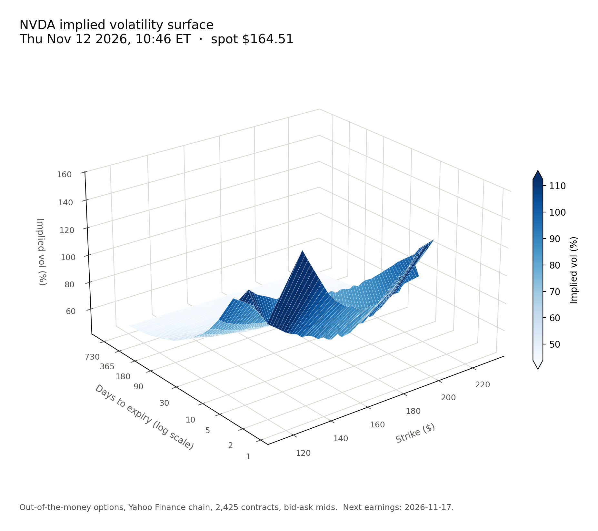
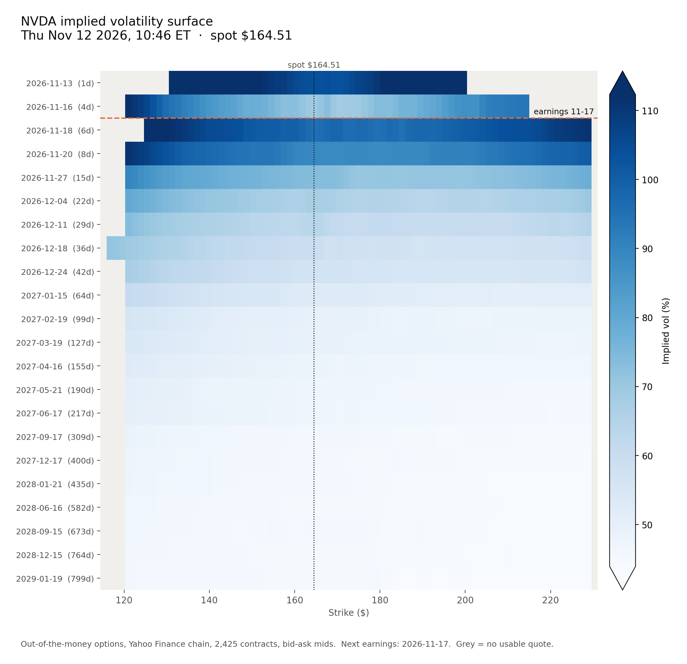

# iv_surface: implied-volatility surface pictures

This folder is one self-contained piece of the group project. It pulls a stock's options chain, works out the
implied volatility (IV) of every option, and saves PNG pictures of the IV surface at that moment. It is set up for
NVDA (the long straddle pitch) but takes any ticker.

Nothing else in the repo depends on it, and it needs no API key.

| 3D surface | Heatmap |
|---|---|
|  |  |

## Setup (once)

You need Python 3.10 or newer.

```bash
cd iv_surface
```

```bash
pip install -r requirements.txt
```

## Use

Picture of the surface right now:

```bash
python vol_surface_png.py
```

It prints the two files it wrote, in `iv_surface/output/`:

- `NVDA_surface_<date>_<time>.png`: 3D surface, strike by days to expiry by IV.
- `NVDA_heatmap_<date>_<time>.png`: the same numbers as a flat grid. Use this one when you need to read values.

The time in the file name and in the picture title is New York time.

Another ticker:

```bash
python vol_surface_png.py AAPL
```

Picture of the surface at an earlier time:

```bash
python vol_surface_png.py --at "2026-11-12 10:50"
```

`--at` uses the latest saved snapshot at or before that New York time. Yahoo does not provide past options chains,
so the only times available are the ones when somebody ran the tool. See which exist:

```bash
python vol_surface_png.py --list
```

Every live run saves a snapshot to `data/snapshots/<TICKER>/`. **Commit and push those files** so the whole group
can redraw the same moment. To build a history, run the tool once a day during market hours (9:30 to 16:00 New York).

### Options

| Option | Default | What it does |
|---|---|---|
| `--min-moneyness`, `--max-moneyness` | 0.7, 1.4 | Strike range shown, as a fraction of the stock price |
| `--max-days` | none | Leave out expiries further away than this, e.g. `--max-days 90` to zoom in on the near term |
| `--elev`, `--azim` | 24, -128 | Camera height and rotation of the 3D picture, in degrees |
| `--no-save` | off | Do not save a snapshot of this pull |

## How to read the pictures

- **Strike axis:** the smile. IV is higher for strikes far from the current price than at the money.
- **Expiry axis:** the term structure. It is on a log scale because the expiries around earnings are days apart
  and the longest ones are years away.
- **Earnings:** the heatmap draws a dashed line at the next earnings date. Expiries just after it carry much higher
  IV than the ones just before, because the market prices in the earnings move. That gap is the core of the
  straddle pitch: a long straddle pays if the actual move is bigger than the one this IV implies.
- **Colour:** light is low IV, dark is high. The colour range is clipped at the 2nd and 98th percentile so a few
  extreme quotes do not wash out the rest; the arrows on the colour bar mark values beyond it.
- **Grey cells (heatmap) and gaps (3D):** no usable quote at that strike for that expiry.

## How the IV is computed

1. **Chain:** every listed expiry from Yahoo Finance through `yfinance`. Quotes are about 15 minutes delayed.
2. **Price per option:** the midpoint of bid and ask. Options with no bid, or a bid-ask spread wider than 50% of the
   mid, are dropped. If the market is closed and Yahoo has blanked the quotes, the last trade of that session is
   used instead and the picture's footnote says so (those pictures are noisier).
3. **Forward price per expiry:** from put-call parity (`call - put = discount * (forward - strike)`) at the five
   strikes nearest the stock price. This picks up dividends and borrow cost without assuming them.
4. **IV:** the volatility that makes the Black-76 formula match the option's price, found by bisection.
5. **Which options:** out-of-the-money only, puts below the forward and calls above. They are the liquid ones.
6. **Grid for the picture:** pandas pivots the result into a table of expiries by strikes and interpolates each
   expiry linearly along strike, only between strikes that are actually quoted. Nothing is smoothed or extrapolated.

Time to expiry is calendar days / 365, measured to the 4pm New York close on the expiry date. The risk-free rate is
the 13-week Treasury bill (`^IRX`).

## Limits

- NVDA options are American-style and the formula is European. The error is small for out-of-the-money options on
  a stock with almost no dividend, but it is not zero.
- Very short expiries (1 to 2 days) have jumpy IV in the wings. Do not read much into them.
- The earnings date comes from Yahoo and can be an estimate. Check it against the company's investor relations page.
- Yahoo's own `impliedVolatility` column will not match exactly, especially for short expiries.

## Files

| File | Purpose |
|---|---|
| `vol_surface_png.py` | The command you run. Reshapes the data with pandas and draws the PNGs with matplotlib. |
| `iv_core.py` | Data pull, quote filtering, forward, implied vol, snapshots. No plotting. |
| `check_iv.py` | Offline tests on a made-up chain with a known answer: `python check_iv.py` |
| `data/snapshots/` | Saved chains with computed IV, one `.csv.gz` and one `.json` per run. Committed. |
| `output/` | Generated PNGs. Not committed. |
| `docs/` | The example pictures above. |

To use the numbers in your own code:

```python
import iv_core as core
raw, mkt = core.fetch_chain("NVDA")
table = core.compute_iv(raw, mkt)          # one row per option: strike, expiry, price, forward, iv, delta...
term = core.term_structure(table, mkt)     # per expiry: at-the-money IV, straddle cost, break-evens
```
